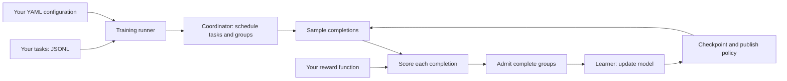

# Qwen RL Framework

[简体中文](README.zh-CN.md)

Train language models with grouped rollouts and reward-based updates. Start with
one local CPU process; use the lower-level interfaces for custom environments
and separately configured Learner/Worker deployments.

You provide **tasks and a reward function**. The framework collects complete
sample groups, runs learner updates, publishes policy versions, and saves the
state needed to resume.

## How it fits together



The `qwen-rl train` example below uses a local HF/PEFT model for both sampling
and learning. The shared core also has Worker, runtime and cluster integration
interfaces; these require their own deployment profiles. The CPU example does
not automatically provision a distributed deployment. See the
[architecture guide](docs/ARCHITECTURE.md) for those boundaries.

## Try the CPU example

First download/unpack the source archive or clone this repository and open its root directory. On Linux with Python 3.11 or 3.12:

```bash
git clone https://github.com/alexbar445/qwen-rl-framework.git
cd qwen-rl-framework
python3 -m venv .venv
. .venv/bin/activate
python -m pip install .
python -m qwen_rl.examples.minimal
```

This runs a scalar-policy example through the coordinator, performs Adam updates, and checks that a restored checkpoint follows the same next update as an uninterrupted copy. It needs no model download, dataset, GPU, ARC toolkit, or Teacher service. It is a framework-path example, not language-model training or a GPU performance result.

Start here for [installation, output, and checkpoint behavior](docs/GETTING_STARTED.md). The other guides cover [architecture](docs/ARCHITECTURE.md), [custom environments and rewards](docs/EXTENDING.md), and [support and evidence](docs/SUPPORT.md).

## Train a real model on CPU

The [small-model recipe](examples/small_model/README.md) trains a LoRA adapter
on the pinned SmolLM2-135M model. In the activated environment above:

```bash
python -m pip install --index-url https://download.pytorch.org/whl/cpu "torch==2.10.0"
python -m pip install '.[small-model]'
qwen-rl train --config examples/small_model/train.yaml --run-dir ./runs/small-model --steps 2
```

The first run downloads about 272 MB of model assets. This CPU recipe samples
one-token `yes`/`no` answers to twelve included arithmetic questions and performs
real LoRA/AdamW updates. It is a bounded training example, not a model-quality
benchmark or a general free-form generation recipe.

Continue the same run, preserving optimizer, scheduler, RNG and task position:

```bash
qwen-rl train --resume --run-dir ./runs/small-model --steps 4
```

`--steps 4` means **four updates in total**, including those already completed.

## Add your own task and reward

This local starter supports two single-token answer choices. You can change
the questions and scoring without implementing an engine or a Worker. For
other generation environments, use the [advanced adapter guide](docs/EXTENDING.md).

Create a directory in the repository root:

```bash
mkdir -p my_task
```

**1. Add data** in `my_task/tasks.jsonl`, one task per line. `task_id` must be unique;
`prompt` is sent to the model and `answer` is available to your reward function.

```jsonl
{"task_id":"even-2","prompt":"Is 2 an even number? Answer yes or no:","answer":"yes"}
{"task_id":"even-3","prompt":"Is 3 an even number? Answer yes or no:","answer":"no"}
```

**2. Write the reward** in `my_task/my_reward.py`. Return a finite number for
each completion; higher means better. The framework passes a typed `Task`, not
an engine or a runtime object.

```python
from qwen_rl.training import Task


def reward(task: Task, completion: str) -> float:
    expected = task.answer.strip().casefold()
    actual = completion.strip().casefold()
    return 1.0 if actual == expected else 0.0
```

**3. Connect them** in `my_task/train.yaml`:

```yaml
schema: qwen-rl-training/v1
model:
  id: HuggingFaceTB/SmolLM2-135M
  revision: 93efa2f097d58c2a74874c7e644dbc9b0cee75a2
  device: cpu
  dtype: float32
task:
  data: tasks.jsonl
  choices: [" yes", " no"]
  reward: my_reward:reward
  reward_schema: even-exact/v1
  source_identity: even-demo/v1
```

The data path is relative to the YAML file. `my_reward:reward` means the
`reward` function in the importable `my_reward` module. The leading spaces in
the choices match this model's tokenization; both choices must be single tokens.
Training settings use the starter defaults, including four samples per group.

**4. Train, then resume**, from the repository root:

```bash
PYTHONPATH="$PWD/my_task" qwen-rl train --config my_task/train.yaml --run-dir ./runs/my-task --steps 2
PYTHONPATH="$PWD/my_task" qwen-rl train --resume --run-dir ./runs/my-task --steps 4
```

Keep the reward module importable on both commands. Resume uses the saved
configuration and frozen task data; changed reward code or incompatible
configuration is rejected. Use a new run directory when changing the experiment.
The runner handles sampling, scoring, complete-group admission, updates and
recovery; a reward function does not need to implement any of that machinery.

## Integrations and evidence

ARC and Bonsai are optional reference integrations; neither is required by either CPU example. The SmolLM2 weights are fetched separately from Hugging Face at the revision pinned by the recipe. Other model weights, datasets, runtime images, credentials, and external services are supplied separately. Support is specific to a configuration and its evidence. Code or an optional dependency being present does not validate every model, backend, GPU, or multi-host setup.

See the [ARC](examples/arc/README.md) and [Bonsai](examples/bonsai/README.md) notes and the [public release evidence scope](docs/PUBLIC_RELEASE.md). Contributions and third-party materials are covered by [CONTRIBUTING.md](CONTRIBUTING.md) and [THIRD_PARTY_NOTICES.md](THIRD_PARTY_NOTICES.md).

The linked guides are distributed in the source archive/repository. A standalone
wheel contains the runtime package and declared resources, not the documentation
tree. Read the [hosted getting-started guide](https://github.com/alexbar445/qwen-rl-framework/blob/main/docs/GETTING_STARTED.md)
when using an installed wheel.
