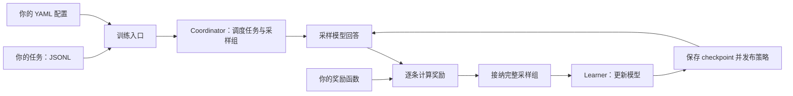

# Qwen RL Framework

[English](README.md)

通过分组 rollout 和奖励驱动的更新来训练语言模型。先从单机 CPU 流程入手；
需要自定义生成环境或 Learner/Worker 部署时，再使用底层接口和独立的部署配置。

你提供**任务与奖励函数**，框架负责收集完整采样组、执行更新、发布策略版本，
以及保存恢复训练所需的状态。

## 架构概览



下方的 `qwen-rl train` 在一个进程内使用 HF/PEFT 模型完成采样和学习。
共享核心还提供 Worker、runtime 和 cluster 集成接口，但需要各自的部署配置；
CPU 示例不会自动配置分布式部署。具体边界见[架构指南](docs/ARCHITECTURE.md)。

## 运行 CPU 示例

Linux、Python 3.11 或 3.12：

```bash
git clone https://github.com/alexbar445/qwen-rl-framework.git
cd qwen-rl-framework
python3 -m venv .venv
. .venv/bin/activate
python -m pip install .
python -m qwen_rl.examples.minimal
```

示例用标量策略经过 coordinator、执行 Adam 更新，并检查从 checkpoint 恢复后，下一步结果是否与未中断副本一致。不需要下载模型或数据，也不使用 GPU、ARC toolkit 或 Teacher 服务。这只是框架流程示例，不是语言模型训练或 GPU 性能结果。

参见[安装、输出和 checkpoint 说明](docs/GETTING_STARTED.md)、[架构](docs/ARCHITECTURE.md)、[接入自定义环境与奖励](docs/EXTENDING.md)和[支持范围与证据](docs/SUPPORT.md)。

## 在 CPU 上训练真实模型

[小模型 recipe](examples/small_model/README.md) 使用固定 revision 的
SmolLM2-135M 训练 LoRA adapter。在上方已激活的虚拟环境中执行：

```bash
python -m pip install --index-url https://download.pytorch.org/whl/cpu "torch==2.10.0"
python -m pip install '.[small-model]'
qwen-rl train --config examples/small_model/train.yaml --run-dir ./runs/small-model --steps 2
```

首次运行下载约 272 MB 模型资源。示例对仓库内 12 道算术题采样单 token 的
`yes`/`no` 回答，并执行真实的 LoRA/AdamW 更新。这是有限任务上的训练示例，
不代表模型质量提升或通用自由文本生成能力。

继续同一训练，保留优化器、scheduler、RNG 和任务位置：

```bash
qwen-rl train --resume --run-dir ./runs/small-model --steps 4
```

`--steps 4` 表示**累计完成四次更新**，包含已经完成的更新。

## 添加自己的任务与奖励函数

这个本地入门流程支持两个单 token 答案选项。你可以替换问题和评分方式，
不需要实现 engine 或 Worker。其他生成环境请参考[进阶 adapter 指南](docs/EXTENDING.md)。

在仓库根目录建立：

```bash
mkdir -p my_task
```

**1. 添加数据**：创建 `my_task/tasks.jsonl`，每行一道题。`task_id` 必须唯一；
`prompt` 发给模型，`answer` 供奖励函数使用。

```jsonl
{"task_id":"even-2","prompt":"Is 2 an even number? Answer yes or no:","answer":"yes"}
{"task_id":"even-3","prompt":"Is 3 an even number? Answer yes or no:","answer":"no"}
```

**2. 编写奖励**：创建 `my_task/my_reward.py`。每个回答返回一个有限数值，
数值越高代表越好。框架传入类型化的 `Task`，无需接触 engine 或运行时对象。

```python
from qwen_rl.training import Task


def reward(task: Task, completion: str) -> float:
    expected = task.answer.strip().casefold()
    actual = completion.strip().casefold()
    return 1.0 if actual == expected else 0.0
```

**3. 连接数据与奖励**：创建 `my_task/train.yaml`：

```yaml
schema: qwen-rl-training/v1
model:
  id: HuggingFaceTB/SmolLM2-135M
  revision: 93efa2f097d58c2a74874c7e644dbc9b0cee75a2
  device: cpu
  dtype: float32
task:
  data: tasks.jsonl
  choices: [" yes", " no"]
  reward: my_reward:reward
  reward_schema: even-exact/v1
  source_identity: even-demo/v1
```

数据路径相对于 YAML 文件。`my_reward:reward` 表示可导入的 `my_reward` 模块中的
`reward` 函数。选项开头的空格用于匹配这个模型的 tokenizer；两个选项都必须是
单 token。其余训练参数使用入门默认值，包括每组四条采样。

**4. 训练并恢复**：在仓库根目录执行：

```bash
PYTHONPATH="$PWD/my_task" qwen-rl train --config my_task/train.yaml --run-dir ./runs/my-task --steps 2
PYTHONPATH="$PWD/my_task" qwen-rl train --resume --run-dir ./runs/my-task --steps 4
```

两条命令都需要能够导入奖励模块。恢复时使用已保存的配置和冻结的任务数据；
奖励代码或不兼容配置发生变化会拒绝恢复。更换实验时使用新的运行目录。
采样、评分、完整组接纳、更新和恢复均由框架负责，无需在奖励函数中实现。

## 集成与证据

ARC 与 Bonsai 是可选参考集成，CPU 示例不依赖它们。SmolLM2 权重由 recipe 按固定 revision 从 Hugging Face 单独下载；其他模型权重、数据、运行镜像、凭证和外部服务须由使用者单独准备。支持范围绑定具体配置及其证据；源码中存在某段代码或可选依赖，不代表所有模型、backend、GPU 或多机布局都已验证。

参见 [ARC](examples/arc/README.md)、[Bonsai](examples/bonsai/README.md)、[公开发行证据范围](docs/PUBLIC_RELEASE.md)、[贡献指南](CONTRIBUTING.md)和[第三方声明](THIRD_PARTY_NOTICES.md)。

请先取得并解压源码（或克隆仓库），再在项目根目录运行以上命令。完整指南随源码分发；单独安装 wheel 不会安装文档目录。

已安装 wheel 的用户可阅读[在线入门指南](https://github.com/alexbar445/qwen-rl-framework/blob/main/docs/GETTING_STARTED.md)。
