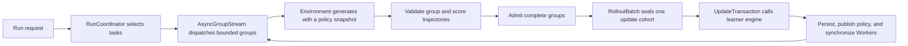

# Architecture

The public training core separates task/environment behavior, rollout collection, and learner updates. A run is a finite request owned by `RunCoordinator`; a model backend or reference integration supplies the policy and generation details.

## Run and rollout flow

1. `RunCoordinator` selects tasks from the injected environment's task catalog. Training requests use training tasks; diagnostic requests use the environment's fixture task.
2. `AsyncGroupStream` bounds concurrent generation and outstanding groups. Each generation request carries a policy snapshot. A completed group remains complete as it moves through admission; a run does not train on a partial group.
3. At the adapter boundary, the framework checks the returned group's policy version, worker-to-trajectory mapping, token/mask/log-probability arrays, and metrics shape. The `RewardScorer` then returns one finite `Reward` for every trajectory. The scalar reward and optional components are attached before group admission.
4. `RolloutBatch` seals the required number of groups for an update and checks that their group IDs, sizes, policy adapter hashes, and policy versions agree. Its policy-lag check allows only the versions admitted by the current run mode.
5. `UpdateTransaction` performs pre-update checks, calls the selected learner engine, records the committed update, and coordinates checkpoint and policy publication. Updated policy versions are synchronized with the Workers before they are used for later generation.

Environment metadata is checked when an adapter enters the run, and each external group response is normalized once at the group boundary. After that, the coordinator and update path carry the typed task, group, reward, batch, and policy records.

## Extension boundary

An `Environment` owns the task catalog, fixture task, stable prompt/reward/source identities, and `generate_group`. It returns complete groups with the Learner's required trajectory fields. A `RewardScorer` assigns one reward per returned trajectory. See [Extending the framework](EXTENDING.md) for the interface and a verified small example.

`create_learner_app(..., environment=..., reward_scorer=...)` selects this generic boundary and does not load the ARC task source, prompt builder, ARC service, or ARC AgentLoop. BEPA and held-out ARC evaluation remain ARC-adapter features in this public snapshot; the generic injection path rejects those settings rather than silently treating them as supported.

## Backends and topology

The coordinator describes shared control flow. It does not make a backend, model, placement, or network topology interchangeable. Learner engines own optimizer/model computation; Worker managers own generation and policy synchronization; deployment adapters provide runtime and host setup. Each such profile needs its own dependencies, configuration, assets, and evidence. See the [support matrix](SUPPORT.md) before interpreting source presence as a validated deployment.
